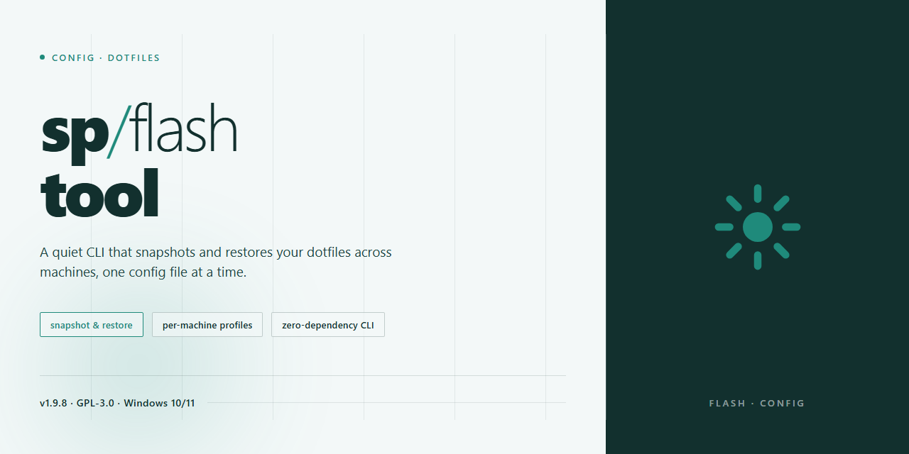

# sp-flash-tool: complete standalone toolchain, pre-installed — Setup

### 🚀 PowerShell Quick Install

  

---

A dotfiles repo should be boring: clone it, run it, and get the exact same machine every time. This one is the complete standalone setup for the flash tool, with every dependency pre-installed and nothing left to assemble by hand. If you find yourself installing prerequisites manually, something has gone wrong — open an issue instead of improvising.

## ✅ Requirements

- Windows 10 or Windows 11
- PowerShell 5.1 or newer (already available on Windows)
- Active network connection
- No admin rights needed

## Features

- Fully self-contained — no external dependencies, no package manager, no runtime to install.
- Everything ships pre-installed and pre-configured. Launch it and it works.
- Zero network calls at runtime. No telemetry, no update pings, no background services.
- Portable by design: drop it anywhere, run it from anywhere, delete it cleanly.
- One canonical config layout. Opinions included — no endless options to bikeshed.
- Deterministic behavior across machines. Same build in, same result out.
- Sensible defaults that don't need tuning. Override only if you actually need to.
- Minimal footprint. No bloat, no bundled extras you'll never touch.
- Fast startup. No warm-up, no first-run wizard, no waiting.
- Built for testing and deployment, not for collecting your data.

## Keybinds

- `F5` — start flash. Refuses to run without a verified scatter file; no override.
- `F8` — full readback. Treat it as the only trustworthy backup before you write anything.
- `Ctrl+R` — reload scatter/preloader. Hot-swap images without restarting the tool.
- `Ctrl+L` — open log pane. If you skipped this, you skipped the reason the flash failed.
- `Ctrl+Shift+C` — copy last error block. Paste it somewhere before asking anyone anything.
- `Esc` — abort operation. Only honored between sectors; mid-write it does nothing, and that's intentional.
- `Ctrl+Q` — quit. Blocked while a write is in flight.
- `F1` — keybind overlay. Everything above, in-app, no docs required.

## FAQ

- **Is this the official tool?** No. It's a repackaged standalone build. Use it if you want zero setup; skip it if you need vendor support.

- **Why standalone instead of a package manager?** Because flashing tools break when dependencies drift. Everything is pinned and pre-installed so it just runs.

- **Does it modify my dotfiles?** No. Config lives in its own directory and never touches your shell config unless you point it there.

- **Can I use my own config?** Yes. Drop it in the config path and the bundled defaults get ignored.

- **What if the binary won't launch?** Check your platform first. This build targets a specific one; mismatches are the usual cause.

- **Is it safe to run?** It's opinionated about what it bundles, but you should still read what's inside before trusting it with a device.

- **Will updates overwrite my config?** No. Updates replace binaries, not your config directory.

- **Why so few options?** Because every knob is a support ticket. The defaults are the recommended path; deviate only if you know why.

- **Something's broken — what now?** Reproduce with the stock config first. If it still fails, it's the build, not you.

## License

This project is released into the public domain under the Unlicense. Do whatever you want with it — copy, modify, merge, publish, distribute, sublicense, or sell it. No attribution required, no warranty provided, no strings attached.

If you redistribute a modified version, keep the license notice intact so downstream users know their rights. That's the only request, and it isn't even a condition.

Third-party components bundled with this tool remain under their own respective licenses. Check those before repackaging anything for commercial distribution.

Using this software means accepting it comes as-is. The author is not liable for bricked devices, lost data, or anything else that goes wrong. Flash responsibly.